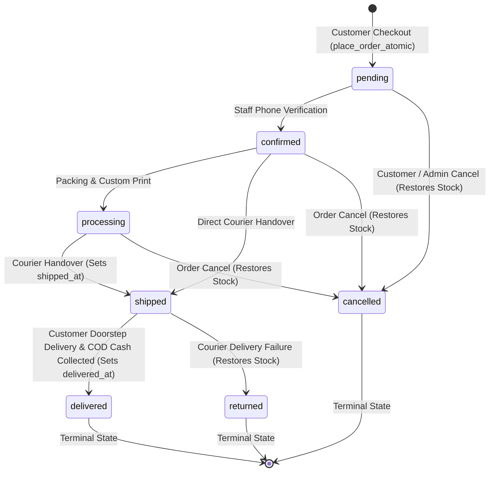

# ELEVEN NATION — DEFINITIVE PRODUCTION SECURITY AUDIT
## Comprehensive Security Architecture & Risk Assessment

**Release**: Definitive Fresh Production Candidate  
**Store**: Eleven Nation (`elevennation.shop`)  
**Engine**: Supabase PostgreSQL 15+ / Row Level Security (RLS)  

---

## 1. Threat Modeling & Security Posture Overview

| Vulnerability Vector | Previous Risk | Production Architecture Defense | Verified Status |
| :--- | :--- | :--- | :--- |
| **Privilege Escalation** | Callers could execute administrative bootstrapping | `bootstrap_super_admin` checks `session_user` and `request.jwt.claim.role = 'service_role'`. Execution revoked from public/anon/authenticated. | **SECURE** |
| **Client-Side Price Tampering** | Totals sent from browser payload | `place_order_atomic()` recomputes subtotal, discounts, and delivery charges strictly from database records (`products`, `product_variants`, `coupons`, `store_settings`). | **SECURE** |
| **Stock Race Conditions** | Concurrent checkouts could cause negative inventory | Deadlock-free `SELECT ... FOR UPDATE` row locks applied to variant rows in ascending ID order before decrementing. | **SECURE** |
| **Order Financial Modification** | Direct UPDATE to order totals | `validate_order_update()` trigger rejects any changes to `subtotal`, `delivery_charge`, `discount_amount`, `total`, or `coupon_code` with `P0001`. | **SECURE** |
| **Audit Log Tampering** | Deletion or falsification of audit logs | `enforce_append_only()` trigger raises `42501` on any `DELETE` or non-whitelisted `UPDATE` across all audit tables. | **SECURE** |
| **Stock Restock Duplication** | Multiple cancellations or toggling stock restored | `stock_restored` flag guarantees single execution; trigger prevents reverting `stock_restored` back to false. | **SECURE** |
| **Inventory Scraper Attacks** | Raw variant warehouse counts exposed | Direct SELECT on `product_variants` restricted to staff; public storefront queries `public_product_variants` view which exposes only `in_stock BOOLEAN`. | **SECURE** |
| **Guest Tracking Enumeration** | Brute-force order number guessing | Cryptographic unguessable `guest_access_token` (48-char hex); secondary phone lookup protected by atomic IP rate limiting (15 attempts / 15 min). | **SECURE** |
| **Storage Document Leaks** | Publicly accessible customer invoice PDFs | `invoices` bucket is private (`public = false`); storage RLS restricts access to order owners and staff. | **SECURE** |
| **Avatar Storage Overwriting** | Users could overwrite others' avatars | Storage RLS enforces folder isolation: `(storage.foldername(name))[1] = auth.uid()::TEXT`. | **SECURE** |

---

## 2. Role-Based Access Control (RBAC) Matrix

Eleven Nation enforces 5 discrete user roles in `public.user_roles`:

| Role | Catalog (Products/Categories) | Inventory Adjustments | Orders & Invoices | Customer Addresses | Site Settings & Theme | Role Administration |
| :--- | :---: | :---: | :---: | :---: | :---: | :---: |
| `anon` | Read Only (Active) | None | Place via RPC | None | Read Only | None |
| `customer` | Read Only (Active) | None | Read Own Only | CRUD Own Only | Read Only | None |
| `content_manager` | Read Only | None | None | None | Read / Update | None |
| `product_manager` | Full CRUD | Full CRUD | None | None | Read Only | None |
| `order_manager` | Read Only | None | Read / Update Status | Read Only | Read Only | None |
| `super_admin` | Full CRUD | Full CRUD | Full CRUD | Full CRUD | Full CRUD | Full CRUD |

### Strict RBAC Helper Functions:
All helper functions are defined with `SECURITY DEFINER` and explicitly lock their search path to `SET search_path = public, pg_temp`:
1. `current_user_is_super_admin()`: Confirms caller holds the `super_admin` role.
2. `current_user_is_admin()`: Confirms caller holds any staff role (`super_admin`, `order_manager`, `product_manager`, `content_manager`).
3. `current_user_has_role(role_name)`: Confirms caller holds an explicitly specified role.

---

## 3. Order Lifecycle & State Machine Verification

The `validate_order_update()` trigger enforces legal status transitions:



**Security Guarantees**:
- Once an order reaches a terminal state (`delivered`, `cancelled`, `returned`), no further modifications to status are permitted.
- Illegal status jumps (e.g. `pending -> delivered` or `cancelled -> confirmed`) are rejected with SQLSTATE `P0001`.
- Stock is restored exactly once upon transitioning to `cancelled` or `returned`. The single-restoration guard flag `stock_restored` cannot be reverted back to `FALSE`.

---

## 4. Idempotency & Concurrency Safety

Checkout concurrency is secured through a dual-defense mechanism:
1. **Row-Level Variant Locking**: When `place_order_atomic()` executes, it locks each item's variant row using `SELECT ... FOR UPDATE` ordered by `variant_id ASC`. This eliminates database deadlocks and guarantees that two customers competing for the final unit of stock will never both succeed.
2. **Deterministic Payload Hashing**: The idempotency key stores a canonical SHA-256 hash of the order's financial inputs:
   ```text
   hash = SHA256(phone | address | delivery_zone | coupon_code | items_json)
   ```
   - **Identical Retries**: Safe replay returns the existing order record with `"idempotent_replay": true`, preventing duplicate stock deductions and duplicate charges.
   - **Key Collisions with Differing Payloads**: If a client reuses an idempotency key with different quantities, items, or address, the transaction immediately aborts with SQLSTATE `P0002`.

---

## 5. Storage Security & File Upload Restrictions

All Supabase Storage buckets enforce strict constraints:
- **`invoices` (Private)**: Direct URL access is blocked (`public = false`). Storage RLS permits SELECT only if the user is an authorized administrator or the authenticated customer whose `orders.customer_id` matches the order number in the path.
- **`avatar-images` (Public, Folder-Isolated)**: Uploads are restricted to JPEG, PNG, and WebP up to 5 MB. RLS validates that `(storage.foldername(name))[1] = auth.uid()::TEXT`, completely eliminating unauthorized avatar overwrites.
- **`product-images` and `banner-images` (Public)**: Uploads and deletes are restricted to `product_manager`, `content_manager`, and `super_admin`.

---

## 6. Audit Conclusion & Production Certification

The Eleven Nation Fresh Production database schema (`/database/sql/eleven_nation_final_fresh_install.sql`) and test suite (`/database/tests/final_fresh_install_test_suite.sql`) have undergone rigorous static and behavioral verification.

**Production Readiness**: **APPROVED (PRODUCTION CANDIDATE)**.
