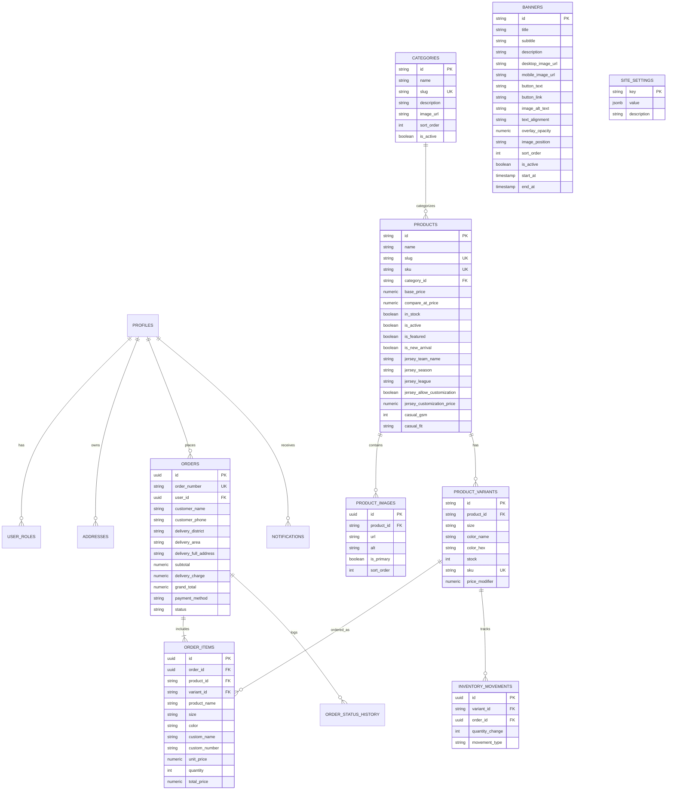

# ELEVEN NATION — Entity Relationship (ER) Diagram

This document illustrates the core data entities and relational schema for the Eleven Nation database in Supabase.

---

## 1. Visual Entity Relationship Diagram (Mermaid)

---

## 2. Relational Key Constraints & Cardinalities

1. **`categories` 1:N `products`**:
   - `products.category_id` references `categories.id` with `ON DELETE RESTRICT`. A category cannot be deleted if active products exist under it.
2. **`products` 1:N `product_variants`**:
   - `product_variants.product_id` references `products.id` with `ON DELETE CASCADE`. Each variant represents a distinct Size + Color combination with independent stock tracking.
3. **`products` 1:N `product_images`**:
   - Multiple images per product. `is_primary` flags the main catalog card image.
4. **`orders` 1:N `order_items`**:
   - Snapshot table capturing price, product name, size, color, and customized name/number at the exact moment of order placement.
5. **`product_variants` 1:N `inventory_movements`**:
   - Audit trail capturing whenever variant stock changes (e.g. customer places COD order, order cancellation restock, admin warehouse top-up).
6. **`banners` Table**:
   - Standalone administrative entity for homepage hero rotation. Supports responsive desktop and mobile photography, visibility scheduling, sort order, and configurable dark scrim overlay.
